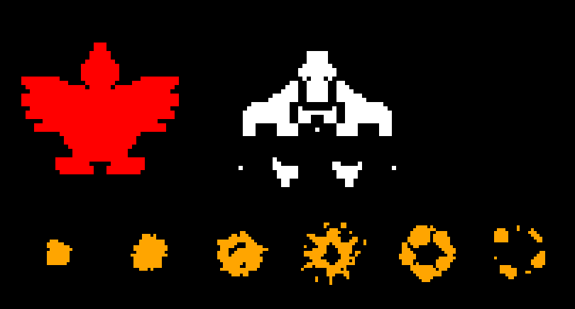
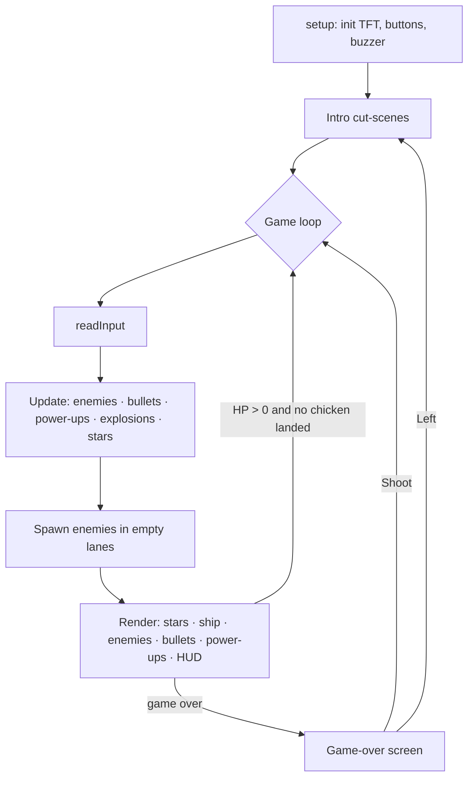

<div align="center">

# 🐔 Chicken Invaders — ESP32 Edition

**A complete arcade space shooter running bare-metal on an ESP32 with a 2.8" ILI9341 TFT, five buttons and a buzzer.**


[▶️ **Watch the gameplay video**](https://drive.google.com/file/d/1zOo3ZzdR95o4YqMiwzx0JBTG-9xbH1RV/view?usp=sharing) &nbsp;·&nbsp; [🕹️ **Play it in your browser (Wokwi)**](https://wokwi.com/projects/402380395905841153)



<sub>In-game 1-bit sprites (rendered from the bitmaps in the source): enemy, player ship and the 6-frame explosion animation.</sub>

</div>

---

## Overview

Intergalactic chickens have come to invade Earth — and you're the last line of defence.

This project recreates the classic *Chicken Invaders* arcade experience on a microcontroller with no game engine, no OS and no frame buffer. Everything — sprite rendering, collision detection, enemy AI, power-ups, animations and sound — is written from scratch in ~950 lines of C++ on top of the Adafruit GFX library.

## Features

- **Story intro** — animated multi-screen cut-scene over a scrolling starfield.
- **4-lane enemy waves** — chickens spawn in four columns with randomised descent speeds and return fire.
- **Dynamic difficulty** — enemy fire rate increases as your score climbs (−200 ms per 200 points).
- **Free 2-D movement** — fly anywhere on screen with four direction buttons; rate-limited firing.
- **Power-up system** — 20% drop chance on every kill:

  | Power-up | Effect |
  |----------|--------|
  | 🔥 Double Firepower | Twin bullets at 2× fire rate for 5 s |
  | ❤️ Health Restore | +50 HP (capped at 100) |
  | 🛡️ Temporary Shield | Immune to all damage for 5 s |

- **HP & scoring** — 100 HP; −5 per bullet hit, −10 per collision; +10 points per chicken. A chicken reaching Earth (bottom of screen) ends the game.
- **6-frame explosion animations** and a continuously **scrolling starfield** background.
- **Sound effects** via buzzer for hits, collisions and game over.
- **Game-over screen** with restart / return-to-title.

## Technical Highlights

- **Dirty-rectangle rendering** — only moved sprites are erased and redrawn each frame, giving smooth animation over SPI without a full frame buffer (a 240×320×16-bit buffer would need 150 KB of RAM).
- **Fixed-size object pools** for enemies, bullets, power-ups and explosions — zero dynamic allocation, deterministic memory use.
- **AABB collision detection** across all entity pairs (player ↔ enemy, bullets ↔ enemy, enemy bullets ↔ player, power-ups ↔ player).
- **Sprites stored in flash** (`PROGMEM`) as 1-bit bitmaps to keep SRAM free.
- **Non-blocking timing** with `millis()` for fire rate, power-up durations and enemy shooting intervals.

## Hardware

| Component | Qty |
|-----------|:---:|
| ESP32 DevKit (ESP32-WROOM-32) | 1 |
| 2.8" ILI9341 SPI TFT, 240 × 320 | 1 |
| Tactile push buttons | 5 |
| Passive buzzer | 1 |
| Breadboard + jumper wires | — |

### Wiring

**TFT display (VSPI)**

| ILI9341 | ESP32 GPIO |
|---------|:----------:|
| CS   | 15 |
| RST  | 4  |
| DC   | 2  |
| MOSI | 23 |
| SCK  | 18 |
| MISO | 19 |
| VCC / LED | 3V3 |
| GND  | GND |

**Controls & audio** — buttons use the internal pull-ups, so wire each one between the GPIO and **GND**.

| Function | ESP32 GPIO |
|----------|:----------:|
| ⬆️ Up    | 12 |
| ⬇️ Down  | 13 |
| ⬅️ Left  | 14 |
| ➡️ Right | 27 |
| 🔫 Shoot | 33 |
| 🔊 Buzzer (+) | 25 |

## Getting Started

### Option A — Run in the browser (no hardware)

Open the [Wokwi simulation](https://wokwi.com/projects/402380395905841153) and press ▶. Use the on-screen buttons to play.

### Option B — Flash a real ESP32

1. Install the [Arduino IDE](https://www.arduino.cc/en/software) and add ESP32 support (*Boards Manager → "esp32" by Espressif*).
2. Install the libraries (*Library Manager*):
   - Adafruit GFX Library
   - Adafruit ILI9341
   - Adafruit ST7735 and ST7789 Library *(used for colour constants)*
3. Clone and open the sketch:
   ```bash
   git clone https://github.com/imeselhy/Chicken_Invaders_ESP32.git
   ```
   Open `chicken_invaders/chicken_invaders.ino`.
4. Select **ESP32 Dev Module**, choose the port, and click **Upload**.

<details>
<summary>Using arduino-cli instead</summary>

```bash
arduino-cli core install esp32:esp32
arduino-cli lib install "Adafruit GFX Library" "Adafruit ILI9341" "Adafruit ST7735 and ST7789 Library"
arduino-cli compile --fqbn esp32:esp32:esp32 chicken_invaders
arduino-cli upload  --fqbn esp32:esp32:esp32 -p /dev/ttyUSB0 chicken_invaders
```
</details>

## How to Play

| Button | Action |
|--------|--------|
| Shoot | Start game / skip intro / fire |
| Up / Down / Left / Right | Move the ship |
| Shoot *(game over)* | Play again |
| Left *(game over)* | Back to title screen |

Shoot the chickens before they reach the bottom, dodge their bullets, and grab power-ups as they fall.

## Repository Structure

```
Chicken_Invaders_ESP32/
├── chicken_invaders/
│   └── chicken_invaders.ino   # Game source (Arduino sketch)
├── simulation/
│   ├── libraries.txt          # Wokwi library list
│   └── wokwi-project.txt      # Wokwi project reference
├── docs/
│   └── images/                # Sprites, screenshots, wiring diagram
└── README.md
```

## Game Architecture



## Future Improvements

- [ ] Persistent high score using ESP32 `Preferences` (NVS flash)
- [ ] Boss chicken every N waves
- [ ] Split into modules (`render`, `entities`, `input`, `audio`)
- [ ] DMA-driven SPI transfers for higher frame rates
- [ ] Custom PCB / handheld enclosure

## Author

**Ibrahim Meselhy**
[GitHub](https://github.com/imeselhy) · [LinkedIn](https://www.linkedin.com/in/your-profile)

---

<sub>Fan-made, non-commercial tribute to the original *Chicken Invaders* series by InterAction studios. Not affiliated with or endorsed by them.</sub>
